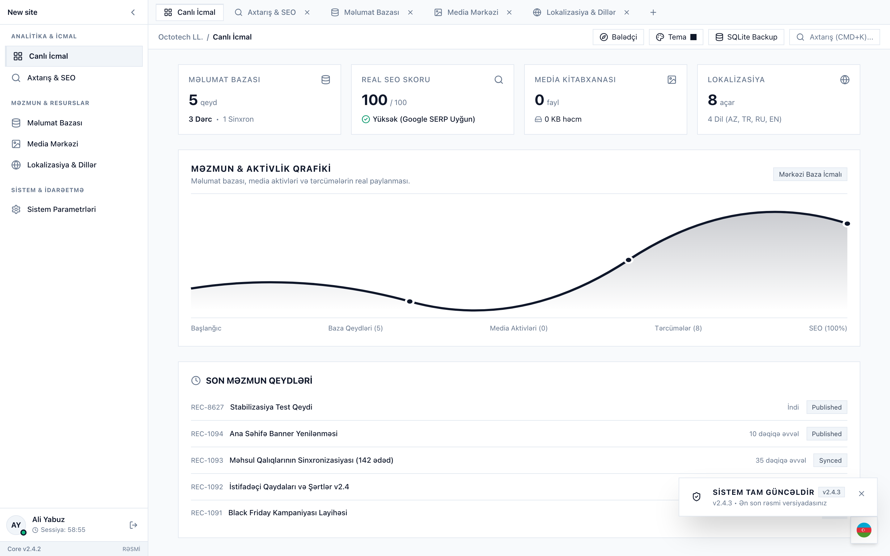
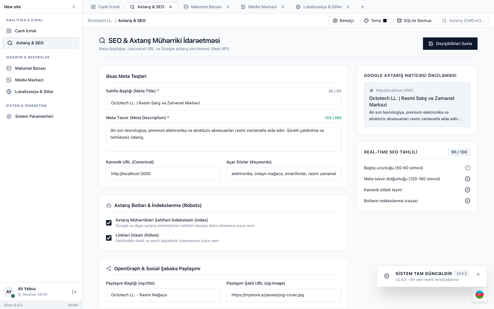
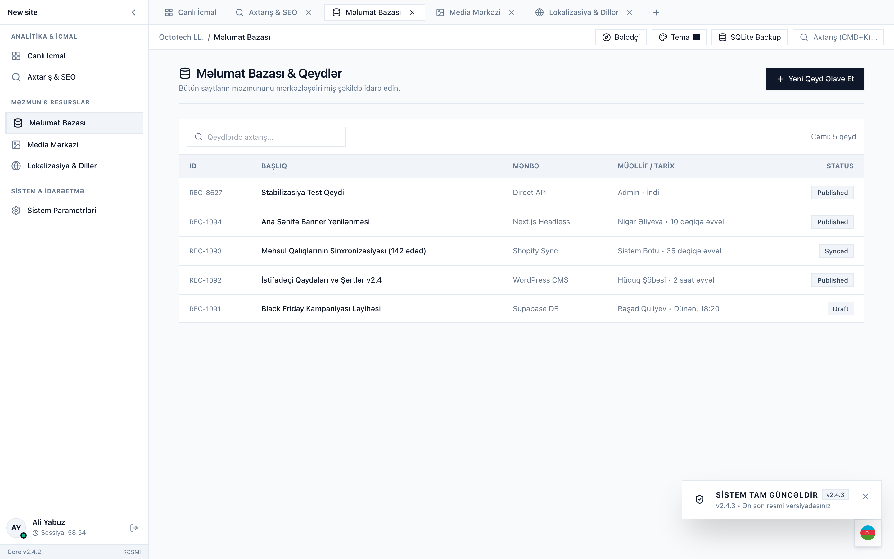
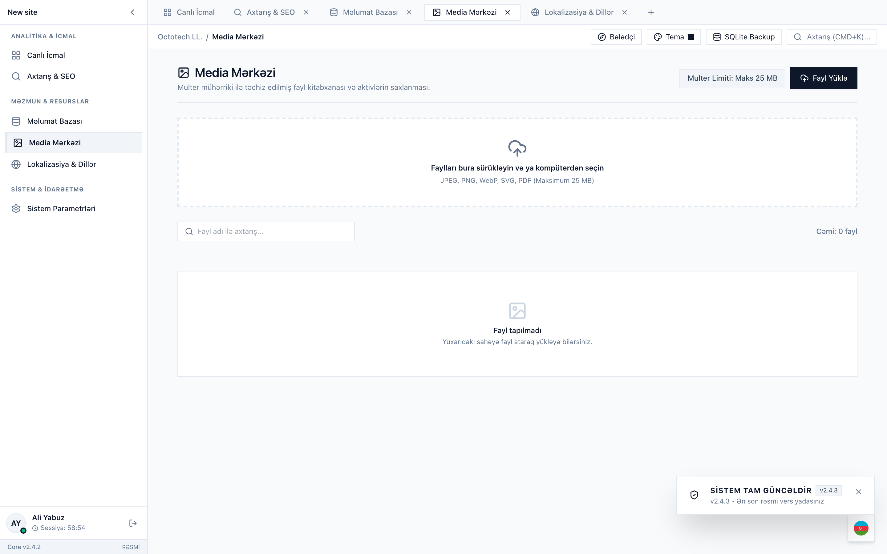
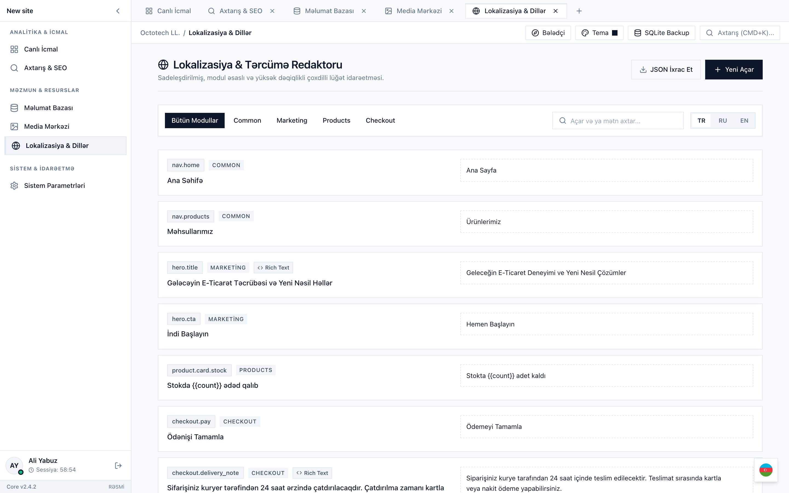
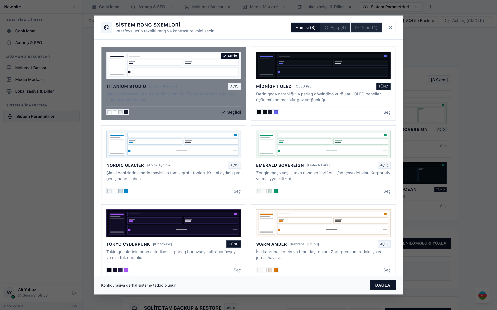
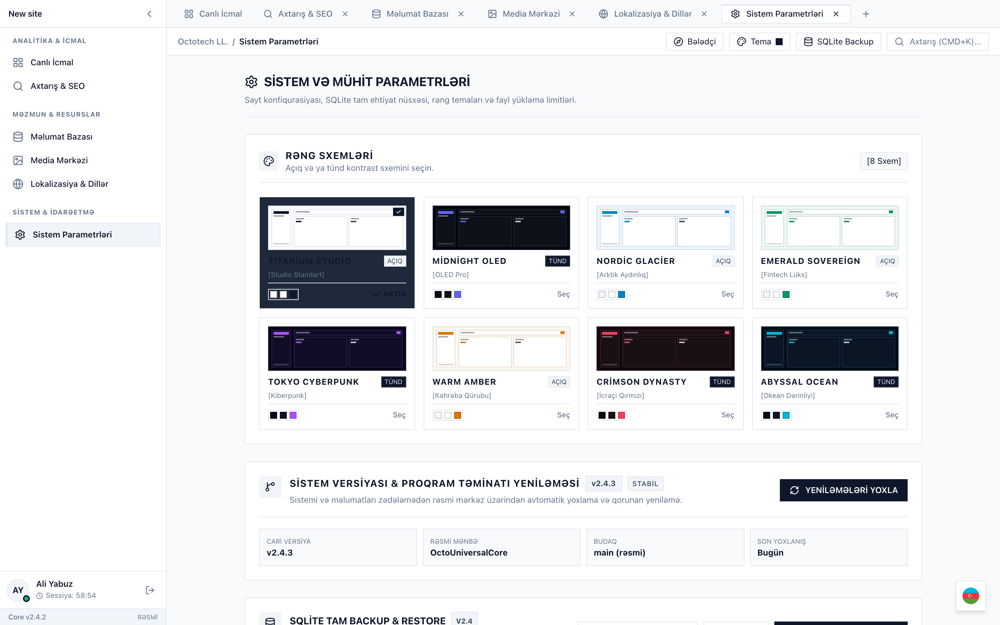
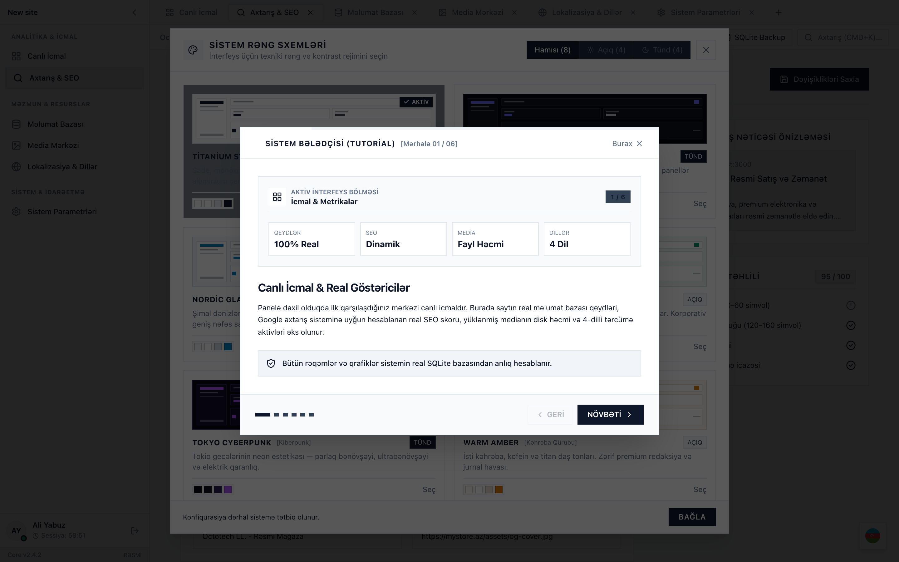
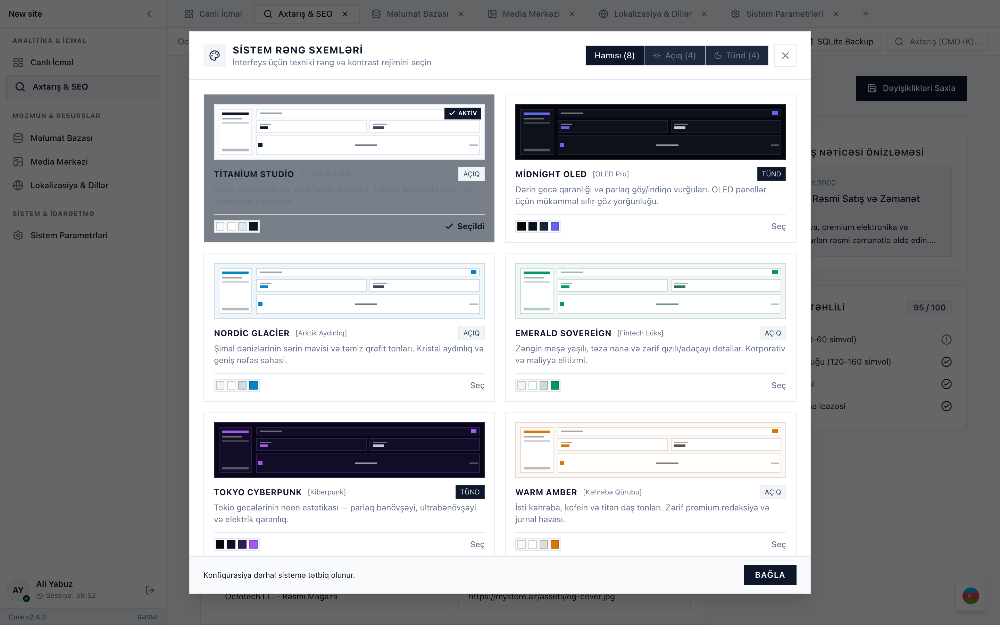

# Octotech Universal Admin Controller & Core Engine

> **İstehsalat Dərəcəli Mərkəzi İdarəetmə Paneli, Dinamik SEO Diaqnostikası, 4-Dilli Lokalizasiya və Atomik SQLite Verilənlər Bazası Arxitekturası.**

---

## 📖 Mündəricat

1. [Sistemə Ümumi Baxış və Əsas Fəlsəfə](#-sistemə-ümumi-baxış-və-əsas-fəlsəfə)
2. [Fəsil 01: Canlı İcmal (Dashboard) və Real Metrikalar](#-fəsil-01-canlı-icmal-dashboard-və-real-metrikalar)
3. [Fəsil 02: Çoxlu Vərəqlər (Multi-Tab Workspace) və Naviqasiya](#-fəsil-02-çoxlu-vərəqlər-multi-tab-workspace-və-naviqasiya)
4. [Fəsil 03: Axtarış & Real Google SERP İdarəetməsi (SEO)](#-fəsil-03-axtarış--real-google-serp-idarəetməsi-seo)
5. [Fəsil 04: Məlumat Bazası (Records) və Məzmun Cədvəli](#-fəsil-04-məlumat-bazası-records-və-məzmun-cədvəli)
6. [Fəsil 05: Media Mərkəzi & Multer Yükləmə Sistemi](#-fəsil-05-media-mərkəzi--multer-yükləmə-sistemi)
7. [Fəsil 06: 4-Dilli Lokalizasiya Mərkəzi (AZ / TR / RU / EN)](#-fəsil-06-4-dilli-lokalizasiya-mərkəzi-az--tr--ru--en)
8. [Fəsil 07: 8 AAA-Keyfiyyətli Rəng Teması və Fərdi Qalereya](#-fəsil-07-8-aaa-keyfiyyətli-rəng-teması-və-fərdi-qalereya)
9. [Fəsil 08: Sistem Versiyası & Sistemi Bozmadan Təhlükəsiz Yeniləmə](#-fəsil-08-sistem-versiyası--sistemi-bozmadan-təhlükəsiz-yeniləmə)
10. [Fəsil 09: İnteraktiv Bələdçi (Tutorial), CMD+K və Sessiya Təhlükəsizliyi](#-fəsil-09-i̇nteraktiv-bələdçi-tutorial-cmdk-və-sessiya-təhlükəsizliyi)
11. [Fəsil 10: Sistem Parametrləri & SQLite Backup Bərpası](#-fəsil-10-sistem-parametrləri--sqlite-backup-bərpası)
12. [Quraşdırma və Başlatma Təlimatı](#-quraşdırma-və-başlatma-təlimatı)

---

## 🎯 Sistemə Ümumi Baxış və Əsas Fəlsəfə

**Octotech Universal Admin Controller**, müasir veb layihələrini, e-ticarət portallarını və yüksək təhlükəsizlik tələb edən korporativ platformaları idarə etmək üçün sıfırdan hazırlanmış mərkəzi panel nüvəsidir. Sistem adi "hazır şablon" və ya "süni AI slop" görüntüsündən tamamilə uzaqlaşaraq aşağıdakı ciddi standartlar üzərində qurulmuşdur:

- **Apple SF Pro Şrift Ailəsi:** Bütün düymələr, başlıqlar, cədvəllər və giriş sahələri sistem səviyyəsində yüksək oxunaqlılıq təmin edən SF Pro Display və SF Pro Text şriftləri ilə təchiz edilib.
- **100% Flat və Kəskin Köşəli Dizayn:** Lazımsız böyük radiuslar, emojilər və ulduzlar ləğv edilmiş; cəsarətli, kəskin 1px çərçivə və qüsursuz kontrast sistemi tətbiq olunmuşdur.
- **Atomik SQLite Arxitekturası:** Bütün qeydlər `.tmp swap` metodu ilə yazılır; serverin qəfil sönməsi zamanı belə məlumatlar 100% bütöv qalır.

---

## 📊 Fəsil 01: Canlı İcmal (Dashboard) və Real Metrikalar

Sistemdə heç bir süni və ya təsadüfi məlumat (fake data) yoxdur. Əsas paneldəki bütün rəqəmlər və paylanma qrafiki birbaşa məlumat bazasından canlı hesablanır.

### Əsas Xüsusiyyətlər:
- **4 Real Göstərici Kartı:**
  1. **Məlumat Bazası:** Saytdakı real məzmun sətirlərinin sayı və sinxronizasiya statusu.
  2. **Dinamik SEO Skoru:** Meta başlıq, təsvir, kanonik URL və robot indeksləşmə parametrləri əsasında dinamik hesablanan 0-100% bal.
  3. **Media Kitabxanası:** Diskdəki faylların real sayı və dəqiq formatlanmış həcmi (Bytes, KB, MB, GB).
  4. **Lokalizasiya:** Baza üzrə idarə olunan aktiv tərcümə açarlarının sayı (AZ, TR, RU, EN).
- **Real Paylanma Dalğa Qrafiki (SVG):** Süni CDN axınları ləğv edilmiş; qrafikin vektor dalğaları və nöqtələri birbaşa 4 əsas modulun faktiki qeydlərindən formalaşır.
- **Son Fəaliyyət Jurnalı:** Baza üzrə edilmiş ən son dəyişikliklərin tarixi və statusu (`published`, `synced`, `draft`).

---

## 🗂️ Fəsil 02: Çoxlu Vərəqlər (Multi-Tab Workspace) və Naviqasiya

Eyni anda birdən çox bölmədə fasiləsiz işləməyə imkan verən paralel vərəq sistemi.

### Əsas Xüsusiyyətlər:
- **Paralel Rejim:** Brauzer kimi SEO, Baza, Media, Lokalizasiya və Parametrlər vərəqlərini eyni vaxtda açıq saxlaya bilərsiniz.
- **Daimi Yaddaş (State Persistence):** Hansı vərəqin açıq və aktiv olduğu `localStorage`-də saxlanılır; səhifə yeniləndikdə daxil edilmiş mətnlər itmir.
- **Üst Fəaliyyət Zolağı (Action Bar):**
  - **Dinamik Breadcrumb:** Aktiv bölmənin ünvan yolu.
  - **Bələdçi (Tutorial):** 6 mərhələli sistemi izah edən interaktiv tur qısayolu.
  - **Tema:** Aktiv rəng göstəricisi ilə 8 tema arasında tək kliklə keçid.
  - **SQLite Backup:** Bütün saytın tam nüsxəsini anında `.sqlite` faylı kimi endirmə.
  - **Axtarış (CMD+K):** Bütün sistem menyularına sürətli qısayol.

---

## 🔍 Fəsil 03: Axtarış & Real Google SERP İdarəetməsi (SEO)

Saytınızın axtarış sistemlərində ən ideal şəkildə indekslənməsi üçün nəzərdə tutulmuş peşəkar SEO aləti.

### Diaqnostika və Parametrlər:
| Parametr | Standart Limit | Funksional Təyinat | Diaqnostika Rejimi |
| :--- | :--- | :--- | :--- |
| **Meta Title** | 50 - 60 Simvol | Google axtarışında görünən əsas başlıq | Canlı sayğac, normada olduqda yaşıl rəng |
| **Meta Description** | 120 - 160 Simvol | Nəticə altındakı dolğun təsvir mətni | Canlı SERP önizləməsi və kəsilmə yoxlanışı |
| **Canonical URL** | Tam URL (http/https) | Dublikat səhifələrin qarşısını alan kanonik ünvan | Protokol və domen tamlığı |
| **Robots Qaydaları** | Index / Follow | Axtarış botlarının səhifəni indeksləməsinə icazə | Atomik boolean açarları ilə anında idarə |
| **Sitemap URL** | `/sitemap.xml` | Axtarış mühərriki xəritəsi | Real vaxtda API tərəfindən generasiya olunur |

---

## 🗄️ Fəsil 04: Məlumat Bazası (Records) və Məzmun Cədvəli

Saytın bütün dinamik məzmununun, məhsullarının və bloq sətirlərinin mərkəzləşdirilmiş idarəetmə lövhəsi.

### Əsas Xüsusiyyətlər:
- **0ms Gecikməli Süzgəc:** Başlıq, müəllif və ya mənbə adına görə anlıq daxili axtarış mühərriki.
- **Yeni Qeyd Modalı:** Tək kliklə yeni məlumat sətirlərinin əlavə olunması.
- **İstehsalat Statusları:** Hər bir qeydin `published` (dərc edilib), `synced` (sinxronlaşdırılıb) və ya `draft` (qaralama) statusu.
- **Atomik Yazılış:** Server qəfil dayandıqda belə `.tmp` swap sayəsində baza faylı heç vaxt korlanmır.

---

## 🖼️ Fəsil 05: Media Mərkəzi & Multer Yükləmə Sistemi

Bütün şəkil, loqo və sənəd aktivlərinin Multer mühərriki ilə təhlükəsiz saxlanması və idarə olunması.

### Əsas Xüsusiyyətlər:
- **Sürüklə & Burax (Drag & Drop):** Faylları birbaşa brauzer pəncərəsinə ataraq anında yükləmə imkanı.
- **Ciddi Validasiya:** İcazəli formatlar (JPEG, PNG, WebP, SVG, PDF) və maksimum 25 MB həcm limiti.
- **Tək Kliklə Link Kopyalama:** Kart üzərindəki düymə faylın nisbi URL ünvanını dərhal panoya (clipboard) kopyalayır.
- **Dəqiq Ölçü Hesabatı:** Yüklənən hər faylın disk həcmi bayt səviyyəsində ölçülərək formatlanır.

---

## 🌐 Fəsil 06: 4-Dilli Lokalizasiya Mərkəzi (AZ / TR / RU / EN)

Çoxdilli portallar üçün mərkəzləşdirilmiş lüğət və tərcümə idarəetmə modulu.

### Əsas Xüsusiyyətlər:
- **Bərabərhüquqlu 4 Dil:** Azərbaycan, Türk, Rus və İngilis dilləri arasında canlı sinxronizasiya.
- **Modullar Üzrə Qruplaşdırma:** `common`, `marketing`, `products`, `checkout` kimi fərqli sahələr üzrə lüğət bölüşdürməsi.
- **Sətir-İçi (Inline) Redaktə:** İstənilən xanaya klikləyərək modal açmadan mətni cədvəl içində dəyişmək və anında yadda saxlamaq.
- **İxrac (Export):** Bütün lüğət açarlarını tək kliklə JSON formatında frontend layihələrinə köçürmə imkanı.

---

## 🎨 Fəsil 07: 8 AAA-Keyfiyyətli Rəng Teması və Fərdi Qalereya

Bütün səthləri, çərçivələri və vurğu tonlarını anında ahəngdar dəyişdirən 8 fərdi flat rəng sxemi.

### Rəsmi Temalar Cədvəli:
1. **Titanium Studio (Zinc) [Açıq]:** Apple Pro & Vercel minimalizmi. Ultra-təmiz ağ səth və qrafit çərçivələr.
2. **Midnight OLED (Obsidian) [Tünd]:** Dərin gecə qaranlığı və elektrik indiqo vurğuları. Sıfır göz yorğunluğu.
3. **Nordic Glacier [Açıq]:** Şimal dənizlərinin sərin mavisi və təmiz qrafit tonları.
4. **Emerald Sovereign [Açıq]:** Britaniya zümrüdü və lüks korporativ maliyyə elitizmi.
5. **Tokyo Cyberpunk [Tünd]:** Tokio gecələrinin neon estetikası — parlaq bənövşəyi və elektrik qaranlıq.
6. **Warm Amber [Açıq]:** Kəhrəba, kofein və titan daş tonları. Zərif jurnal havası.
7. **Crimson Dynasty [Tünd]:** Dərin tünd şokolad və məxmər qırmızı fon. Yüksək səlahiyyətli icraçı hiss.
8. **Abyssal Ocean [Tünd]:** Dəniz dibinin sirli tünd göyü və parıldayan akvamarin firuzə çalarları.

---

## ⚡ Fəsil 08: Sistem Versiyası & Sistemi Bozmadan Təhlükəsiz Yeniləmə

Mövcud məlumatları və verilənlər bazasını zədələmədən həyata keçirilən atomik yenilənmə sistemi.

### 5 Mərhələli Təhlükəsizlik Protokolu:
1. **[1/5]** Mövcud məlumat bazası və yüklənmiş fayllar təhlükəsizlik rejiminə keçirilir.
2. **[2/5]** SQLite tam sistem nüsxəsi (backup) arxiv qovluğuna qeyd edilir.
3. **[3/5]** Rəsmi mərkəzdən ən son paketlər və dəyişikliklər gətirilir.
4. **[4/5]** Fayl tamlığı və asılılıqlar yoxlanılır.
5. **[5/5]** Sistem heç bir məlumat itkisi olmadan yeni versiyaya keçirilir.

### Açılışda Sağ Alt Toast Bildirişi:
- Panel açılan kimi sağ alt küncdə mikro-proqres xətti ilə **3 saniyəlik atomik yoxlanış** icra edilir.
- Sistem güncəldirsə: *"Sistem Tam Güncəldir (v2.4.2)"* çıxır və 6 saniyə sonra yumşaq bağlanır.
- Yeniləmə varsa: *"Yeniləmə Mövcuddur"* xəbərdarlığı görünür; daxilində **"İndi Yenilə"** və **"Bax"** düymələri təqdim olunur.

---

## 🛡️ Fəsil 09: İnteraktiv Bələdçi (Tutorial), CMD+K və Sessiya Təhlükəsizliyi

İstifadəçi rahatlığı və yüksək səviyyəli təhlükəsizlik alətləri.

| İnteraktiv Sistem Bələdçisi | Sürətli Əmr Palitrası (CMD+K) |
| :---: | :---: |
|  |  |

### Əsas Funksiyalar:
- **6 Mərhələli İnteraktiv Bələdçi Turu:** Panelə ilk dəfə daxil olduqda avtomatik açılır. İcmal, Vərəqlər, SEO, Məzmun, Temalar və Əmrləri addım-addım izah edir (Klaviatura oxları və ESC ilə idarə olunur).
- **Sürətli Əmr Palitrası (`CMD+K` / `Ctrl+K`):** Menyu axtarışına vaxt itirmədən istənilən səhifəyə, rəng temasına və ya funksiyaya anında keçid.
- **Circle PFP & Sessiya Taymeri:** Sol altda administratorun inisiallarını əks etdirən tema tonlu dairəvi profil şəkli və geriyə sayan canlı sessiya taymeri.
- **Sessiya Kilidi (Lock Screen):** Təhlükəsiz çıxış (Logout) edildikdə SF Pro blur pəncərəsi aktivləşir və sessiyanı qoruyur:

---

## ⚙️ Fəsil 10: Sistem Parametrləri & SQLite Backup Bərpası

Bütün sistem konfiqurasiyasının və bazanın ehtiyat nüsxəsinin idarəetmə mərkəzi.

### İmkanlar:
- **Brend & Sayt Parametrləri:** Sayt adı, domeni və mühərrik növü (Next.js, Headless Engine, React).
- **Yükləmə Limitləri:** Maksimum fayl həcmi (1 MB - 100 MB) və icazəli MIME növlərinin dinamik tənzimlənməsi.
- **Tam SQLite Backup Endirmə:** Tək kliklə bütün saytın ikili `.sqlite` nüsxəsini yükləmək.
- **Fayldan Geri Bərpa (Restore):** Əvvəlki `.sqlite` faylını seçərək sistemi bir neçə saniyəyə əvvəlki stabil vəziyyətinə qaytarmaq.
- **Daxili Adminer Meneceri:** `/adminer` ünvanında avtomatik çalışan self-healing xidməti ilə verilənlər bazasını vizual idarə etmək.

---

## 🚀 Quraşdırma və Başlatma Təlimatı

### Tələblər:
- Node.js (v18.0 və ya daha yuxarı)
- npm və ya pnpm
- PHP (Adminer müstəqil meneceri üçün, tövsiyə olunur)

### 1. Repozitoriyanı Klonlayın:
\`\`\`bash
git clone https://github.com/aliyabuz25/OctoUniversalController.git
cd OctoUniversalController
\`\`\`

### 2. Asılılıqları Quraşdırın:
\`\`\`bash
npm install
\`\`\`

### 3. İstehsalat Qurulmasını İcra Edin:
\`\`\`bash
npm run build
\`\`\`

### 4. Serveri Başladın:
\`\`\`bash
npm start
\`\`\`

Server `http://localhost:3000` ünvanında aktiv olacaqdır.  
Adminer verilənlər bazası meneceri `http://localhost:3000/adminer` ünvanında xidmət göstərir.

---

## 📄 Lisenziya və Müəllif Hüquqları
Bu layihə **Octotech LL.** üçün xüsusi olaraq hazırlanmışdır. Bütün hüquqlar qorunur © 2026.
